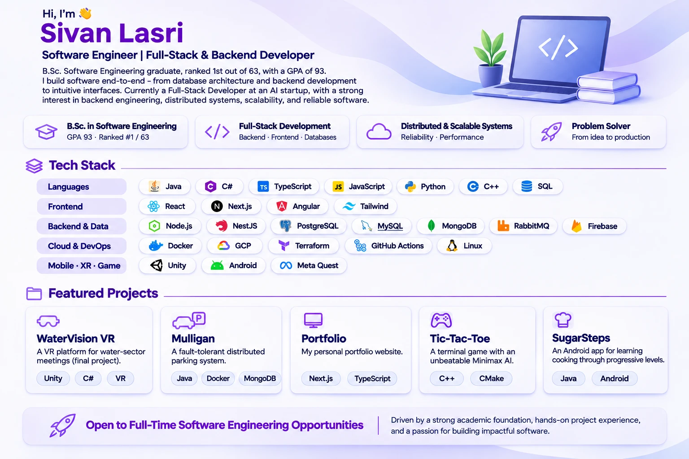

  

&nbsp;

&nbsp;

  

**📂 Projects:**
[WaterVision VR](https://github.com/SivanSoftware/WaterVision_VR) ·
[Mulligan](https://github.com/SivanSoftware/mulligan-parking-system) ·
[Portfolio](https://github.com/SivanSoftware/SivanSoftware.github.io) ·
[Tic-Tac-Toe](https://github.com/SivanSoftware/tic-tac-toe-cpp) ·
[SugarSteps](https://github.com/SivanSoftware/SugarStepsApp)

