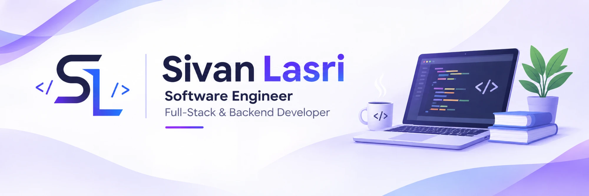

## About

B.Sc. in Software Engineering, graduated **1st out of 63** students with a **GPA of 93**.

I'm a full-stack and backend developer who builds software end to end, from database and API design to the interfaces people actually use. I'm especially drawn to distributed systems, scalable architectures and reliable software, with hands-on experience built through academic and personal projects.

## 🧩 Tech Stack

| Category | Technologies |
| :-- | :-- |
| **Languages** |        |
| **Frontend** |     |
| **Backend & Databases** |        |
| **Cloud & DevOps** |       |
| **Mobile · XR · Game** |    |

## 🚀 Featured Projects

| Project | Description | Tech |
| :-- | :-- | :-- |
| **[WaterVision VR](https://github.com/SivanSoftware/WaterVision_VR)** · [Live](https://watervision-vr.web.app) | A VR platform for water-sector meetings (final project). |    |
| **[Mulligan](https://github.com/SivanSoftware/mulligan-parking-system)** | A fault-tolerant distributed parking system. |    |
| **[Portfolio](https://github.com/SivanSoftware/SivanSoftware.github.io)** · [Live](https://sivansoftware.github.io) | My personal developer portfolio website. |   |
| **[Tic-Tac-Toe](https://github.com/SivanSoftware/tic-tac-toe-cpp)** | A terminal game featuring an unbeatable Minimax AI. |   |
| **[SugarSteps](https://github.com/SivanSoftware/SugarStepsApp)** | An Android app for learning cooking through progressive levels. |   |

## 📫 Contact

